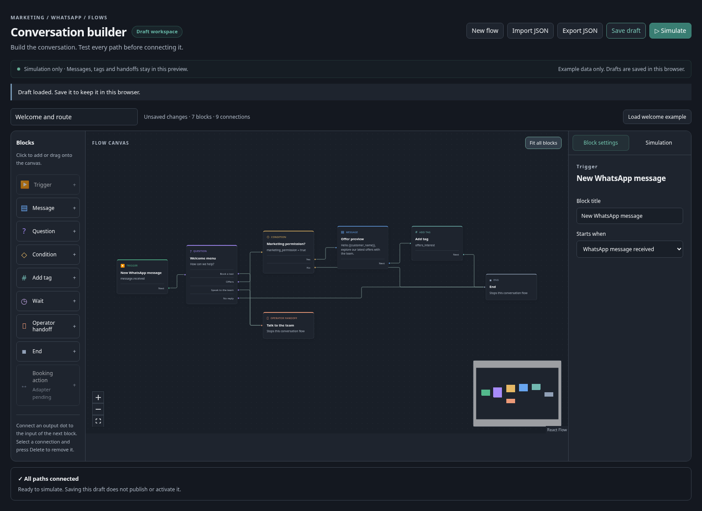

# WhatsApp flow builder — draft and simulation prototype

Route: `/dashboard/marketing/whatsapp/flows`, linked from the WhatsApp tabs and Marketing navigation. Uses the existing TaxiCRM session and `automation.view`; editing additionally requires `automation.manage`. No authentication sharing or NeedACab Plus navigation deployment is introduced.



## Included

A React Flow canvas with draggable blocks, explicit output/input connections, zoom/fit/minimap, selection, deletion and a settings inspector. Blocks: one synthetic inbound-message/tag trigger, message or template preview, up to three answer buttons plus no-reply branch, exact typed conditions, simulated tags, virtual wait, operator handoff and end. The welcome example routes booking/support to a simulated operator; marketing goes through consent. Unsupported booking actions and canonical lifecycle triggers are visibly unavailable. No custom JavaScript/SQL/HTTP node exists.

Drafts use a bounded, allowlisted `taxicrm.flow-draft/v1` JSON format: 64 blocks, 128 connections, 64 KiB, stable node/port IDs. Imported unknown fields/live settings/code/URLs are rejected. Required variables must have nonempty synthetic values. Invalid graphs (missing outputs, duplicates, cycles, unreachable blocks, unknown variables) cannot simulate. Incomplete but structurally valid drafts can be saved for editing.

Explicit local save is scoped to workspace and authenticated user ID. Drafts survive browser reload; JSON import/export provides backup. One current draft per browser/user/workspace; no shared server persistence, publication, immutable live versions or deployed flow list is claimed. Users are told to use example data and that storage is local. Replacing unsaved work asks for confirmation; failed import leaves the current draft intact.

The simulator is a pure synchronous interpreter in `src/lib/marketing/flows/model.ts`. Buttons answer the particular current question; waits advance virtual time manually. It gates marketing consent, free-text/question 24h window, synthetic template approval, missing data and operator takeover. Every action remains in preview: messages are marked SIMULATED, tags affect only copied scenario state and handoff only ends the preview. Editing the graph clears stale answers/results. It imports no sender, booking adapter, database, service contract or credential configuration and makes no network call. A synthetic approved checkbox is not actual Meta evidence.

## Validation

- 11 model/navigation tests passed.
- 13 browser cases passed: branches/consent, interactive answers/tag preview, takeover, closed window, reload persistence, JSON export, invalid import, virtual wait, adding/editing/dragging/connecting/deleting blocks, operator handoff, view-only controls and mobile overflow.
- Browser: zero page errors and zero non-GET/HEAD requests.
- TypeScript and targeted lint passed; full Next production build passed with a synthetic unreachable DB URI (no live credentials or database).

Browser checks use the isolated component preview, not the actual protected dashboard route. Existing server authentication/permission helpers gate that route; no claim of newly tested logged-in full-app RBAC or runtime integration is made.

Reproduce:

```sh
npx tsx --test src/lib/marketing/flows/model.test.ts src/lib/workspace/navigation.test.ts
node scripts/marketing/flow-preview.mjs
# Separate terminal, review tooling Playwright + Chromium required:
npx tsx tests/smoke/whatsapp-flow-builder-browser.mjs
```

Preview binds ONLY 127.0.0.1:5533, serves a whitelist of static files and accepts GET/HEAD only. It builds the real component without importing the application server, NextAuth or a database. It is not copied into the production runtime.

## Separate future work

Complete the proposal review gaps (action-response schema, temporal validation and safe numeric revisions) before consuming PR10/PR32 wire contracts. This prototype does not emit or parse those envelopes. Server persistence/versioning, durable run/question/wait execution, action adapters, canonical events and cross-app access require subsequent reviewed work. Media, free-text answer capture, Meta quick replies/Flows and live message execution are not implemented by this draft canvas. No migration, configuration change, Meta request, real booking or deployment was performed.
