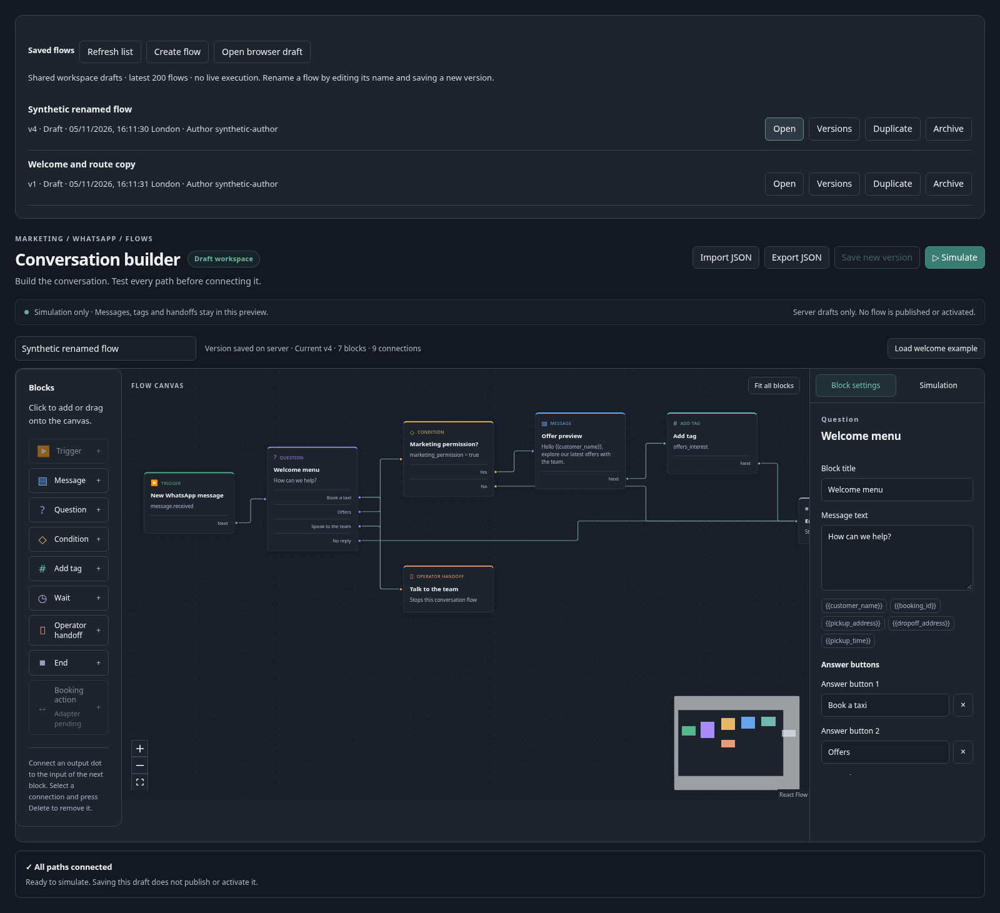

# Shared flow drafts and version history

The existing WhatsApp → Flows page gains a shared server library: create, open, rename through the editor, duplicate, archive and restore. Every successful write creates an immutable content snapshot, with the authenticated author's account ID, London display time and a monotonically increasing revision. Historical versions open read-only and run the existing pure simulator against their exact snapshot. Copying a version creates a separate flow. There is no activation or live execution control.



The canvas still supports JSON backup/import. **Open browser draft** explicitly reads the previous per-account/workspace localStorage draft into a new unsaved server draft. It does not remove the old local copy or write it to the server automatically. A database/API error preserves editor changes; there is no silent fallback that claims a server save succeeded.

## Storage and authorization

`GET/POST /api/dashboard/whatsapp/flows` uses the existing TaxiCRM session and administration access. Both methods require `automation.view`; writes additionally require `automation.manage`. The workspace comes exclusively from server configuration. All object/revision lookups and writes are workspace scoped. POST requires the same Origin as the request URL, JSON content type, bounded streaming input, strict command fields and the existing bounded allowlisted draft parser. No client-supplied author/workspace/live flags are accepted. Responses are private/no-store and unexpected database failures return a generic 503 without SQL or credentials.

Two new tables only: `whatsapp_flow_drafts` (head metadata) and `whatsapp_flow_revisions` (immutable snapshots). Row locking and expected-version checks protect against stale edits and save/archive races. Head update and revision insert commit in the same transaction; a failure rolls both back. Stale edits return 409 and leave the editor unchanged. There is no automatic retry. If an initial create's HTTP result is lost, refresh the list before trying again; this version does not provide a create idempotency key.

Application grants: SELECT/INSERT on these two tables; UPDATE only head name/version/archive/author/time columns. No DELETE and no revision UPDATE. Installer removes default direct grants on these new tables before regranting, and aborts if inherited DELETE or revision UPDATE remains. It leaves default ACLs, existing tables, bookings, webhook configuration and all send flags untouched. Existing read-only grants are preserved. No new workers, triggers, canonical ingestion or Meta adapter calls.

Bounds: list shows latest 200 flows including archived flows; history shows latest 100 revisions. Authors display stable account IDs rather than resolved personal names. Simulation results are not persisted. This is server draft collaboration, not a durable flow runner or publishing system.

## Validation completed

- 16 tests: pure model, navigation and PGlite storage integration. Includes snapshot/author retention, rename, stale revision rejection, workspace isolation, archive/restore, duplication, exact snapshot simulation, transaction rollback and reviewed SQL/grants under the production-style default ACL pattern.
- 13 existing canvas browser scenarios passed.
- 9 library browser scenarios passed: legacy local draft import without writes, create, rename/version, reload/open, conflict preserving edits, historical read-only simulation, historical duplicate, archive/restore and view-only controls. Zero page errors.
- TypeScript, targeted lint, Prisma validation and full Next production build passed with synthetic configuration.

Browser tests intercept the API with synthetic in-memory responses and use actual client components. Database tests use isolated PGlite; they do not establish production PostgreSQL concurrency, live role access or authenticated HTTP integration. Those checks remain release validation, not claimed completed. No production session or credentials were used for tests. No live schema, flag, message or deployment was changed.

Reproduce from repository root:

```sh
npx tsx --test src/lib/marketing/flows/storage.test.ts src/lib/marketing/flows/model.test.ts src/lib/workspace/navigation.test.ts
node scripts/marketing/flow-preview.mjs
# In another terminal, with existing review tooling Playwright + Chromium:
npx tsx tests/smoke/whatsapp-flow-library-browser.mjs
npx tsx tests/smoke/whatsapp-flow-builder-browser.mjs
```

## Release package — not applied

Review `prisma/migrations/20261105160000_whatsapp_flow_versions/migration.sql`, Prisma mappings, and the standalone transaction [install-flow-drafts.sql](release/install-flow-drafts.sql).

Installer SHA-256:

```
60254b9b2081a2a6d1cabe5a68362c4644225a1f043a1f527710886777cac1ec
```

The standalone transaction includes both DDL and narrowed grants and is intended for the existing owner-operated shared-primary release procedure. Do not run it in addition to the raw migration. Do not run an unreviewed blanket `prisma migrate deploy` against this shared database or mark unrelated pending migrations applied. Confirm target identity and table absence first. If the transaction aborts, verify rollback; do not bypass its ACL check.

After approval: apply the exact reviewed transaction from the authorized database runtime, verify structure/grants read-only, then publish this feature. Keep production Meta/test/journey send flags false and controlled mode disabled. Using an authorized user session, verify create/save/version/read-only access and a stale-edit conflict with a clearly named synthetic draft. Verify no provider requests, then archive the synthetic flow. Existing local JSON exports remain portable. If application rollback is needed, restore the previous image and retain the new tables/history; do not drop data.
